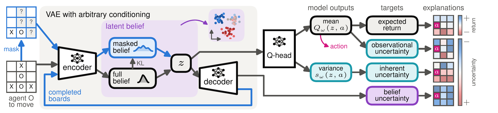

# EXPOSURE

Code for **EXPOSURE: Explaining Sources of Uncertainty in Reinforcement Learning** (ESANN 2027).

<p align="center">
  
</p>

EXPOSURE is a reinforcement learning agent built on one mask-aware belief network. An encoder maps an observation
with any subset of features masked to a latent belief, a Q-head predicts the mean and variance of the return, and a
decoder completes the masked features. The agent acts on its belief from the full observation, and Shapley
explanations use its belief from each coalition $C$ of visible features, so they come from the agent itself.

For each coalition, the explanations attribute

| target | game | question it answers |
|---|---|---|
| expected return | $\hat Q(C) = \mathbb E_z[Q_\omega(z,a)]$ | which features raise or lower the action's value |
| observational uncertainty | $\hat v_{\mathrm{obs}}(C)$, spread of the agent's $Q$ over the decoder's completions | which features make the agent less uncertain of the action's value |
| inherent uncertainty | $\hat v_{\mathrm{inh}}(C) = \mathbb E_z[s_\omega(z,a)]$ | which features reveal how much randomness is left in the rest of the game |
| belief uncertainty | $\hat H(C)$, entropy of the belief over the masked features | which features narrow the agent's belief about the masked ones |

Observational and inherent uncertainty split the return variance by the law of total variance. In tic-tac-toe and
Minesweeper $4\times4$, all $2^n$ coalitions are scored exactly against exact oracles.

## Layout

```
src/exposure_rl/   the method
  vaeac_q.py           belief network (encoder, decoder) with the Q-head, training, coalition and entropy games
  td.py                TD training (the agent acts on its full-observation belief)
  coalitions.py        exact games over all coalitions, Shapley values
  oracle.py            exact tic-tac-toe oracle (Q, return variance, occupancy) and the exact games
  minesweeper.py       exact Minesweeper oracle (uniform posterior over mine layouts)
  minesweeper_exact.py cached exact games for Minesweeper
  opponents.py         random and perturbed-minimax opponents
  masked_dqn.py        the MA-DQN and DQN + surrogate baselines with variance heads
  scalar_surrogate.py  masked surrogate of a standard DQN
  policy_eval.py       exact return moments of an agent's own greedy policy
  exact_eval.py        exact win / draw / loss rates of a policy
  evaluate.py          scoring against the oracle, checkpoint loading
  baselines.py         replay matching and marginal imputation
src/xrl/           tic-tac-toe and Minesweeper environments, opponents and DQN training of the xrl project
scripts/           training, scoring and figures; reproduce_paper.sh runs the whole paper pipeline
tests/             pytest
```

`src/xrl` is the code of Ayça Çelik and Philipp Laur (game rules, opponents, oracle helpers, mask sampler, DQN
training), included with their permission from commit `cba2ba05` of their project.

## Setup

Requires [uv](https://docs.astral.sh/uv/).

```bash
uv sync --all-extras        # JAX with CUDA, Flax, Optax, matplotlib, umap-learn, pytest, ruff
uv run pytest -q
```

On a shared GPU, set `XLA_PYTHON_CLIENT_PREALLOCATE=false`.

## Reproducing the paper

```bash
scripts/reproduce_paper.sh all     # train every agent, score, draw the figures, check the numbers (days on one GPU)
scripts/reproduce_paper.sh score   # everything after training, from checkpoints in results/ (hours)
```

The stages `train`, `score`, `figures` and `numbers` also run alone. `PAR` sets the number of parallel jobs
(default 3, fits 32 GB of GPU memory). Outputs go to `results/`. The last stage, `scripts/paper_numbers.py`,
regenerates Table 1 and checks every number of the paper's text against its LaTeX source, exiting with code 1 on any
mismatch.

Setting: all agents are trained by TD, and the exact oracles are used only for scoring. Networks have two hidden
layers of width 256 (ReLU), latent dimension $d = 16$, $M = 10$ mixture components, 3 seeds and matched update counts.
Tic-tac-toe uses a uniformly random opponent or a perturbed minimax that plays a random move 5% of the time
(`--opponent pm05`, annealed from 100% during training).

### What generates what

| In the paper | Script |
|---|---|
| EXPOSURE agents | `train_td.py --xrl-matched --width 256 --var-weight 50 [--opponent pm05 --anneal-opponent]`, `minesweeper.py --mines 3 --xrl-matched --width 256` |
| Baselines (MA-DQN, DQN + surr.) | `certainty_baselines.py --domain {random,pm05,ms} --method {ma,surr} --seed S` |
| Table 1, $\phi^Q$ and win rates | `replay_matching_eval.py --all-td --xrl-matched --width 256 --replay 10000` |
| Table 1, $\phi^{\mathrm{obs}}$ | `imputation_vobs.py --domains random pm05 ms` |
| Table 1, $\phi^{\mathrm{inh}}$ | `score_own_inherent.py --reference agent` |
| Table 1, $\phi^H$ | `predictive_entropy.py --domain {tictactoe,pm05,minesweeper}` |
| Table 1 (assembled) | `paper_table.py` |
| Text: probes, optimal win rates, checks | `paper_analyses.py {probes,optimal,parity,chain_rule}`, `score_own_state.py`, `mc_noise.py` |
| Figure 1 | `architecture_maps.py --board 1728 --seed 2`, then `architecture_figure.py` |
| Figure 2 (a–c) | `outcome_regions.py --checkpoint results/models/td_random_m10_var_xrl256_s2.msgpack --projection umap` |
| Figure 2 (d) | `paper_figure_cells.py --ttt-board 1728` (`--ttt-boards I J ... --out-dir D` renders many boards) |
| Number check | `paper_numbers.py` |

### Names in the paper and in the code

The code, result files and checkpoints keep earlier names for two games:

| paper | code and results |
|---|---|
| observational uncertainty $v_{\mathrm{obs}}$, $\phi^{\mathrm{obs}}$ | `v_mask`, `vmask`, `phi_mask` |
| inherent uncertainty $v_{\mathrm{inh}}$, $\phi^{\mathrm{inh}}$ | `v_state`, `vs`, `phi_state` |

## Citation

```bibtex
@inproceedings{farhadyar2027exposure,
  title     = {{EXPOSURE}: Explaining Sources of Uncertainty in Reinforcement Learning},
  author    = {Farhadyar, Kiana and Vogt, Yannick and Laur, Philipp and {\c{C}}elik, Ay{\c{c}}a and
               Nematollahi, Iman and Kalweit, Gabriel and Kalweit, Maria},
  booktitle = {European Symposium on Artificial Neural Networks (ESANN)},
  year      = {2027}
}
```

## License

MIT, see [LICENSE](LICENSE).
