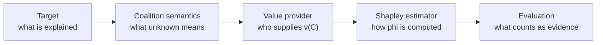

# xrl

`xrl` is a toolkit for **controlled, semantics-aware comparison of explainable
reinforcement-learning methods**. It trains agents, constructs explanation
games, applies interchangeable Shapley estimators, and evaluates whether two
results genuinely answer the same question before comparing them.

The current research program asks whether the exact conditional-occupancy
fixed-action-Q game supplied by SVERL can be scaled first with learned masked
coalition values and then with a genuine SALVAGE-style attribution estimator,
while characteristic-model error, Shapley-estimator error, and
policy-performance cost remain separate measurements. The complete statement,
status, terminology, and experimental invariants live in the
[research program](docs/research-program.md).



| Research capability | Current status |
| --- | --- |
| Exact conditional-occupancy fixed-action-Q game | Implemented for Tic-Tac-Toe |
| SALVAGE-inspired masked categorical characteristic surrogate | Implemented; not SALVAGE |
| Direct mask-aware Q | Implemented |
| Exact, permutation, KernelSHAP, and FastSHAP estimators | Implemented |
| FastSVERL-style learned characteristics | Planned |
| SALVAGE included/excluded attribution estimator | Planned |
| Combined learned characteristic plus SALVAGE estimator | Research target |

The toolkit currently provides:

- **Environments** — two-player PettingZoo Tic-Tac-Toe and single-agent
  Gymnasium Minesweeper.
- **Learning** — tabular Q-learning, online Q-learning, and replay-based DQN.
  DQN supports scalar TD regression and categorical scalar-target Two-Hot or
  HL-Gauss classification, plus optional Direct mask-aware Q training. These
  categorical heads are not C51 return-distribution models.
- **Explainability** — exact SVERL, marginal and cohort SHAP, tree-surrogate
  SHAP, learned masked coalition values, and exact, sampled, KernelSHAP, or
  FastSHAP attribution estimation.
- **Comparison** — structured explanation semantics, coalition fidelity,
  estimator error, agreement, faithfulness, policy performance, and compute.
- **UI** — local browser apps for playing against trained agents with live
  attribution overlays.

## Setup

```bash
uv sync --extra dev                                        # tabular only
uv sync --extra dev --extra neural                         # + neural trainers and UI model loading
uv sync --extra dev --extra neural --extra explain         # + SHAP baselines
uv sync --extra dev --extra neural --extra explain --extra monitoring   # + plots and MLflow
```

## Workflows

### 1. Train an agent

One command for both environments. `--env` picks the game, `--algo` the
learner:

```bash
uv run --extra neural xrl train --env minesweeper --algo dqn --value-head two-hot \
  --rows 4 --columns 4 --mines 3 --episodes 10000 --out runs/ms

uv run --extra neural xrl train --env tictactoe --algo dqn --value-head two-hot \
  --episodes 5000 --out runs/ttt

uv run --extra neural xrl train --env tictactoe --algo dqn --value-head scalar \
  --feature-mask-input --masked-batch-ratio 1 --episodes 5000 --out runs/ttt-direct-q

uv run xrl train --env tictactoe --algo tabular --opponent minimax --out runs/q_minimax
```

The two axes are independent. `--algo` is *how the agent learns* — `dqn` has a
replay buffer and a target network, `online-q` has neither, `tabular` is a
Q-table. `--value-head` is *how the DQN represents its scalar TD target* —
direct scalar regression, or categorical Two-Hot/HL-Gauss classification over
value bins. Every `--algo dqn` run has replay and a target network regardless
of its value head.

`--algo`, `--value-head`, and `--seeds` all accept comma-separated lists and
compose into one sweep:

```bash
uv run --extra neural xrl train --env minesweeper \
  --value-head two-hot,hl-gauss,scalar --seeds 3,26 --out runs/ms-sweep
```

Progress prints to stderr as it trains (rolling win rate, cells revealed,
epsilon, ETA, and every evaluation checkpoint), so the JSON result on stdout
stays pipeable.

`--feature-mask-input` selects the single architecture
`[visible_values, known_mask]`; ordinary policy and target calls pass an
all-ones mask. `--masked-batch-ratio R` then appends `round(R * batch_size)`
masked current-state copies to each replay batch. Thus `R=0` is the matched
architecture control and positive values isolate the effect of masked
supervision. The path works with every DQN value head and currently requires
`--encoder identity`.

Each variant lands in `<algo>_<value-head>/seed_<k>/` with cross-seed
aggregates and a top-level `variants_summary.json`. The value-head axis
collapses for algorithms that have only one — `--algo dqn,online-q
--value-head scalar,two-hot` is three runs, not four. Settings that don't
apply to every selected algorithm are rejected rather than silently ignored.

Neural network capacity on either environment is set with `--hidden-sizes`
(comma-separated layer widths). Minesweeper runs save two models:
`model.msgpack` is the
highest-win-rate checkpoint on the fixed evaluation boards, and
`final_model.msgpack` retains the last training state.

### 2. Play against it

```bash
uv run --extra neural xrl play --runs-dir runs                 # Tic Tac Toe
uv run --extra neural --extra explain xrl play-minesweeper     # Minesweeper
```

Both UIs scan `--runs-dir` recursively and list every loadable run. The
Minesweeper app has an **Explanations** panel that renders per-cell
attributions over the live board and keeps a history of saved results.

### 3. Explain what it learned

```bash
uv run --extra neural --extra explain xrl explain \
  --run runs/ms --method kernel --state rollout:2 --render
```

Seven methods share one result shape. Their structured semantics identify the
target quantity, unknown-feature game, value-model source, and Shapley
estimator, so comparisons do not rely on a method name alone.

`masked-q` can query an explainable-Q run directly:

```bash
uv run --extra neural xrl explain --run runs/ttt-direct-q --method masked-q
```

For a standard categorical DQN, train the separate masked value surrogate for
Surrogate-backed Masked-Q Shapley and, optionally, train the FastSHAP
attribution model over that same coalition game:

```bash
uv run --extra neural xrl train-q-surrogate --run runs/ms --out runs/ms-surr
uv run --extra neural xrl train-fastshap --run runs/ms --q-surrogate runs/ms-surr --out runs/ms-fs
```

Categorical value heads (`--value-head two-hot` or `hl-gauss`) are required by
the masked distributional surrogate, and therefore by FastSHAP when that
surrogate supplies its coalition values, because a `scalar` run has no
distribution to distil. Marginal-imputation FastSHAP and direct mask-aware Q
do not have that restriction. An explicit `--q-surrogate` takes precedence
even when the base run is explainable-Q.

To benchmark the separate surrogate against direct mask-aware training under
matched HL-Gauss settings, run the deterministic Tic Tac Toe walkthrough:

```bash
uv run --extra neural python examples/explainable_q_comparison_walkthrough.py --mode fast
uv run --extra neural python examples/explainable_q_comparison_walkthrough.py --mode research
```

It evaluates every one of the 512 coalitions on fixed probe states against
each policy's own exact, action-legality-conditioned Q oracle. Results and
timings land under `runs/tutorial/explainable_q/<mode>/`; add `--reuse` to keep
fingerprint-matched training artifacts while recomputing the evaluation. The
`research` mode raises the budget but remains a single-seed diagnostic, not a
statistically powered benchmark. Oracle fallback counts disclose partial
coalitions for which no action-legal occupancy donor matches the probe.

### 4. Decide which explanation to trust

```bash
uv run --extra neural --extra explain --extra monitoring xrl compare-explanations \
  --run runs/ms --out runs/comparison/ms --states 64 \
  --q-surrogate runs/ms-surr --fastshap-run runs/ms-fs
```

Scores every method over many held-out states and writes CSVs, bootstrap
confidence intervals, and plots. It separates four questions that are usually
conflated: do methods *agree*, how close is an approximation to the exact
answer for *its own* game, is the attribution *faithful* to the model, and does
a learned coalition game reproduce the exact game it targets.

On Tic Tac Toe, adding `conditional-occupancy:exact` puts an *on-manifold and
exact* arm in the study and scores every method under it. That is what makes the
home-field effect measurable: each method wins under its own game, and a
marginal explainer can score worse than a random ordering once it is judged on
reachable boards. `examples/ttt_full_pipeline.py` runs the whole matrix — both
arms, both value heads, every game crossed with every estimator — end to end.

The same workflow can run on an optional offline executor without changing the
local default or result layout:

```bash
# Modal (the client is optional for local work)
uv sync --extra remote
uv run python examples/ttt_full_pipeline.py --mode fast --backend modal \
  --run-id ttt-fast-modal --out-root runs/bench/ttt-matrix

# ubul requires this one-time interactive host setup
ssh -t ubul 'sudo apt-get install -y tmux'
uv run python examples/ttt_full_pipeline.py --mode fast --backend ubul \
  --run-id ttt-fast-ubul --out-root runs/bench/ttt-matrix
```

Remote runs require a clean commit already pushed to GitHub. `--reuse` also
requires the original `--run-id`. Inspect retained runs and benchmark-backed
automatic selection with `xrl remote-runs list` and
`xrl remote-runs qualifications`; pull again with `xrl remote-runs pull RUN_ID`.
`xrl remote-runs prune RUN_ID` is preview-only until repeated with `--yes`.
`--backend auto` deliberately fails unless a recorded provider satisfies the
20-minute matrix gate; it never silently falls back to a slower target.

To compare the two *learned* games against each other rather than against the
off-manifold one, `examples/ttt_ablation.py` puts both on a single mask-aware
run — one trained with a positive masked batch ratio can also have a surrogate distilled
from it — so the network, and therefore the oracle, is held fixed:

```bash
uv run --extra neural --extra explain --extra monitoring \
  python examples/ttt_ablation.py --mode research \
  --base-matrix runs/bench/ttt-matrix --out-root runs/bench/ttt-ablation
```

It then varies one knob at a time around a baseline and plots each metric
against it. No policy is retrained, so every point is measured against the same
exact reference — which is what lets the sweep separate a knob that moves the
*game* from one that only moves the *estimator*.

### 5. Compare learning methods

Compare runs you already trained — any environment, no retraining:

```bash
uv run xrl compare-runs runs/minesweeper-4x4-3-div --out runs/compare/heads
uv run --extra monitoring xrl compare-plot runs/compare/heads
```

A sweep root expands to one series per variant with its seeds folded in, and
`final_comparison.csv` ranks them at their final checkpoint with the cross-seed
spread. Plotting is a separate command reading the same CSVs, so
`xrl compare-runs ... | xrl compare-plot` works and the comparison itself needs
no extras.

To train the methods as part of the comparison instead (Tic Tac Toe only):

```bash
uv run --extra neural --extra monitoring xrl compare \
  --methods tabular,online-q,dqn-two-hot,dqn-hl-gauss --seeds 0,1,2 --episodes 1000
```

Writes aligned CSVs and plots under `runs/comparison/<timestamp>/`. Add
`--mlflow` here or on `xrl train` to log to a local tracking store.

## Environments

### Tic Tac Toe

```python
from xrl.envs import tictactoe_v0

env = tictactoe_v0.env(obs_mode="planes", render_mode="ansi")
env.reset(seed=42)
```

- `planes`: `observation` shape `(4, 3, 3)`, `action_mask` shape `(9,)`.
- `flat`: perspective-normalized `observation` shape `(9,)`, `action_mask` `(9,)`.

Actions are row-major board positions `0..8`. Baseline opponents: `random`,
`minimax`, and `perturbed_minimax` (starts fully random, anneals toward perfect
play via `--perturbed-minimax-discount`).

The learner uses **seeded-random X/O assignment**: each episode's seed selects
the learner as X or O with probability 0.5. This exposes the learner to both
roles, but it is not strict alternation and a finite run is not guaranteed to
be exactly balanced. Flat observations are learner-relative. See the
[Tic-Tac-Toe experimental contract](docs/research-program.md#tic-tac-toe-experimental-contract)
for the role, opponent, evaluation, and action-mask invariants.

### Minesweeper

```python
import gymnasium as gym
from xrl.envs import minesweeper_v0

env = minesweeper_v0.env(rows=5, columns=5, mines=3, render_mode="ansi")
observation, info = env.reset(seed=42)

env = gym.make("xrl/Minesweeper-v0", rows=5, columns=5, mines=3)
```

Flat observations only: `observation` shape `(rows * columns,)` with `-1`
hidden, `0..8` clue counts, `9` for the exploded mine on a loss; `action_mask`
marks hidden revealable cells. v1 is reveal-only — no flags, no chording. The
first reveal is guaranteed safe. Invalid actions raise.

## Explainability

`xrl.explainability` turns a coalition game into board-feature attributions.
Every method returns the same `ExplanationResult` and satisfies
`sum(attributions) == full_value - baseline_value`; what differs is how each
represents an *unknown* feature and which scalar it explains.

The CLI baselines explain one fixed action value `Q(s,a)`. Exact Tic Tac Toe
SVERL additionally distinguishes behavior `pi(a|s)`, policy prediction
`sum_a pi(a|s)Q(s,a)`, and expected outcome through environment continuation.
The Q model or surrogate supplies coalition values `v(C)`; exact enumeration
or sampled permutations then apply the Shapley transform to produce one
attribution per feature. FastSHAP instead learns that final vector directly.
Consequently, Surrogate-backed Masked-Q Shapley is the repeated-query
reference calculation, while Surrogate-backed FastSHAP adds a second model to
amortize the same game into one attribution pass.

| Method | Unknown features are… | Envs | Extra |
| --- | --- | --- | --- |
| `exact` | imputed from a rollout background, all coalitions enumerated | both, ≤16 features | — |
| `kernel` | same, via KernelSHAP | both | `explain` |
| `cohort-kernel` | imputed from *similar* states only | both | `explain` |
| `tree` | a gradient-boosted surrogate of `Q(·, a)` | both | `explain` |
| `masked-q` | queried from a jointly trained mask-aware Q-function, or an explicit masked surrogate | both | `neural` |
| `fastshap` | represented by its training value model and amortized into one attribution forward pass | both | `neural` |
| `sverl` | marginalized over exact conditional learner-decision occupancy | tictactoe | — |

The first four are **off-manifold**: they compose a board the game could never
reach and read `Q` where it was never trained. `sverl` is **on-manifold** and
exact — it averages over real reachable boards. The masked-Q methods *target*
on-manifold with a learned model. The trade is a theorem, not a preference: only
the off-manifold game gives a feature the model ignores exactly zero, and only
the on-manifold one keeps every query point real. See
[ADR 0021](docs/adr/0021-on-manifold-coalition-game.md).

```python
from xrl.explainability import load_explanation_run, MarginalShapExplainer

run = load_explanation_run("runs/ms")
background = run.adapter.collect_background(run.policy, run.config, states=256, seed=1234)
result = MarginalShapExplainer(run.policy, run.feature_spec, background).explain_action(obs, mask)
```

See [docs/explanations.md](docs/explanations.md) for the method matrix,
prerequisites, and how to read a comparison study.

## Documentation

| Information | Authoritative location |
| --- | --- |
| Purpose, research question, current status, and experimental invariants | [Research program](docs/research-program.md) |
| Installation and common workflows | This README |
| Every command, flag, and saved artifact | [CLI reference](docs/cli.md) |
| Training algorithms, losses, and metrics | [Reinforcement Learning](docs/rl.md) |
| Explanation methods and comparison interpretation | [Explanation Methods](docs/explanations.md) |
| Public Python interfaces | [API reference](docs/api.md) |
| Module ownership and data flow | [Architecture](docs/architecture.md) |
| Theory, literature, and open gaps | [Shapley/RL gap analysis](docs/shap-rl-gap-analysis.md) |
| Historical reasoning and delivery records | [ADRs](docs/adr/) and [plans](docs/plans/) |

Runnable examples live in [examples/](examples/).
